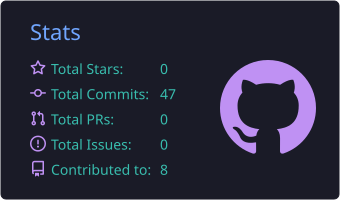
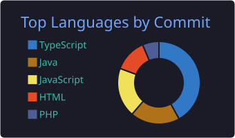
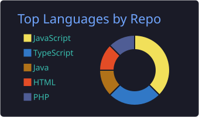
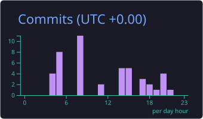

  

  
  
  

---

## 👋 About Me

| | |
|---|---|
| 🎓 **Education** | Pre-final year student at Ramco Institute of Technology |
| 🌱 **Learning** | React, Node.js, Express.js, MongoDB |
| 🎯 **Looking for** | Internship opportunities |
| 📍 **Location** | Rajapalayam, Tamil Nadu |
| 📫 **Reach me** | [LinkedIn](https://www.linkedin.com/in/natarajansri-s-12ba27328) |

---

## 🛠️ Tech Stack

  

---

## 📂 Featured Projects

<table>
  <tr>
    <td width="50%" valign="top">
      <h3>💰 <a href="https://github.com/Natarajansri/Payroll-and-PaySlipGenerator">Payroll & PaySlip Generator</a></h3>
      JavaFX app to manage employees, filter by department/salary, and generate monthly payslips.  
      
      
    </td>
    <td width="50%" valign="top">
      <h3>🏨 <a href="https://github.com/Natarajansri/Hostel-Complaint-System">Hostel Complaint System</a></h3>
      Raise and track maintenance complaints with role-based dashboards for students, admins, and workers.  
      
    </td>
  </tr>
  <tr>
    <td width="50%" valign="top">
      <h3>🩸 <a href="https://github.com/Natarajansri/blood-donor-management-system">Blood Donor Management</a></h3>
      Register donors and search for blood donors by blood group.  
      
    </td>
    <td width="50%" valign="top">
      <h3>🛒 <a href="https://github.com/Natarajansri/online-groceries">Online Groceries</a></h3>
      Online grocery shopping app with product browsing and ordering.  
      
    </td>
  </tr>
  <tr>
    <td colspan="2" valign="top">
      <h3>🕵️ <a href="https://github.com/Natarajansri/Crack-the-Mystery">Crack the Mystery</a></h3>
      Interactive mystery-solving game/app.  
      
    </td>
  </tr>
</table>

---

## 📊 GitHub Stats

  
  

📈 More stats

 

  
  

---

## 🐍 Contribution Snake

  <picture>
    <source media="(prefers-color-scheme: dark)" srcset="https://raw.githubusercontent.com/Natarajansri/Natarajansri/output/github-snake-dark.svg" />
    <source media="(prefers-color-scheme: light)" srcset="https://raw.githubusercontent.com/Natarajansri/Natarajansri/output/github-snake.svg" />
    
  </picture>

---

Thanks for visiting! ⭐

